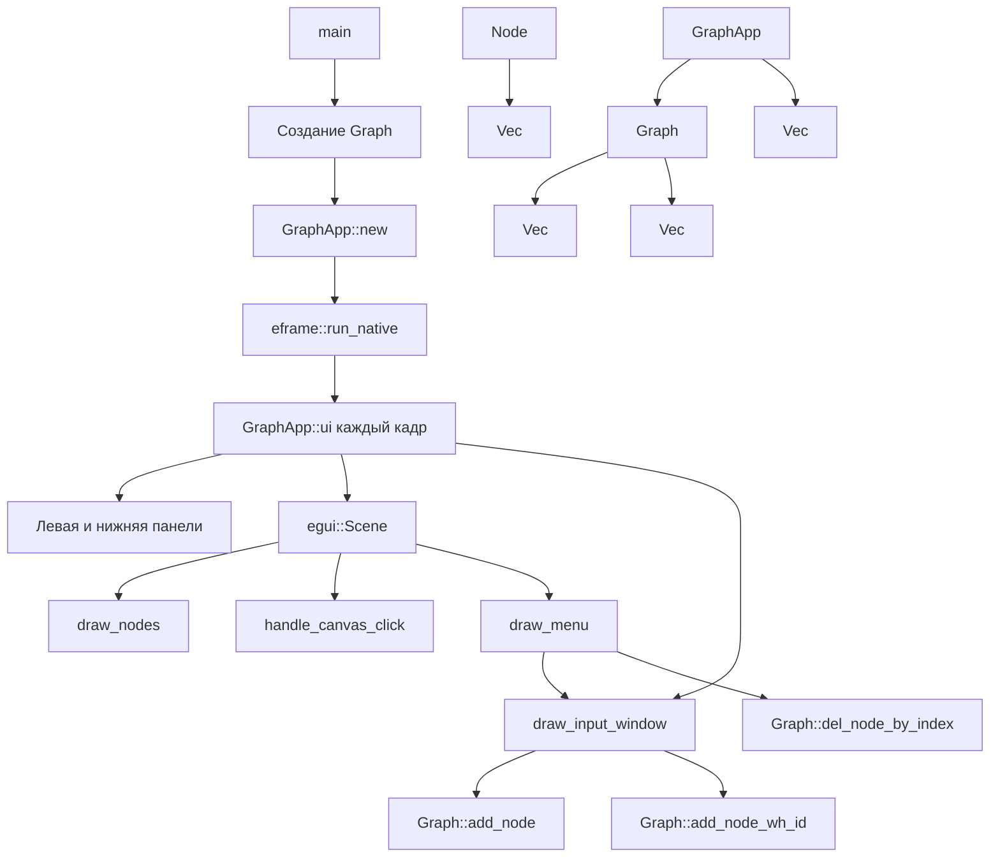
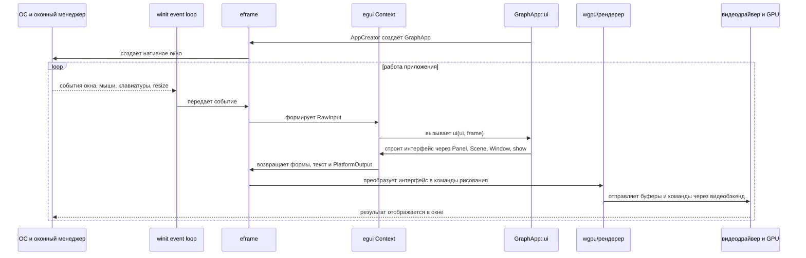

# Архитектура GraphAlgorithm

Документ описывает текущее устройство приложения по исходному коду `src/main.rs` и `src/graph.rs`. Граф хранится в памяти, а `eframe/egui` отвечает за окно, сцену и обработку действий пользователя.

## Общая схема



## Сущности и поля

### `Graph`

`Graph` является моделью графа. Поле `nodes` содержит вершины в порядке хранения. Поле `edges` содержит объекты `Edge`, но текущие операции приложения его не заполняют и не используют. Поэтому фактические связи сейчас задаются через `Node.neighbors`.

### `Node`

`Node.id` — уникальный идентификатор вершины. `Node.neighbors` — список ID соседних вершин. При изменении связей нужно работать с ID, а при отрисовке приложение переводит ID соседа в индекс через поиск в `Graph.nodes`.

### `Edge`

`Edge.capacity` хранит пропускную способность, `Edge.flow` — поток. `Edge::residual_capacity` вычисляет остаточную пропускную способность, а `Edge::is_saturated` проверяет, достигнут ли предел. Эти методы подготовлены для алгоритмов потоков и пока не участвуют в UI.

### `GraphApp`

`graph` — модель данных. `scene_rect` — положение и размер мира `egui::Scene`. `node_positions` хранит экранные координаты вершин. Индекс позиции должен соответствовать индексу вершины в `graph.nodes`. `context_menu_pos` хранит открытое контекстное меню. `input_window` хранит состояние диалога добавления вершины.

### `InputWindow`

`show_add_node_window` управляет видимостью окна. `new_node_id_input` содержит текст ID. `pending_node_pos` хранит место, куда будет добавлена новая вершина. `error_msg` содержит последнюю ошибку ввода. `focus_input` является одноразовым флагом запроса фокуса.

### `Menu`

`ContextMenu(Pos2)` означает меню добавления вершины в свободной точке. `NodeMenu((Pos2, usize))` означает меню вершины и хранит её позицию вместе с индексом в `graph.nodes`.

## Методы модели `Graph`

| Метод | Использует | Назначение и дальнейшее использование |
|---|---|---|
| `del_node_by_index(index)` | `nodes`, `Node.id`, `Node.neighbors` | Удаляет вершину по индексу, удаляет её ID из соседей и возвращает `Ok(removed_id)`. UI вызывает его из меню вершины и удаляет позицию с тем же индексом. |
| `del_node_by_id(id)` | `nodes`, `Node.neighbors` | Ищет вершину по ID, удаляет её и очищает ссылки соседей. Возвращает исходный индекс или `None`. Удобен для внешнего кода, работающего с ID. |
| `add_node_wh_id(id, neighbors)` | `nodes`, переданный список соседей | Добавляет вершину с заданным ID. При занятом ID возвращает `Err`, поэтому координату можно добавлять только после `Ok(())`. |
| `add_node(neighbors)` | `generate_id`, `nodes` | Создаёт вершину со свободным случайным ID. Сейчас метод не возвращает ID, поэтому UI добавляет позицию после успешного вызова без дополнительной проверки. |
| `add_neighbors(id, neighbors)` | `nodes`, `Node.neighbors` | Добавляет связи вершине и обратные ссылки указанным соседям. Вызывающий код должен передавать существующий `id` и согласованные ID соседей. |
| `generate_id()` | `nodes`, генератор `rand` | Генерирует ID от 1 до 999999 и повторяет попытку, пока ID не станет свободным. |

## Методы `GraphApp`

| Метод | Использует | Назначение и дальнейшее использование |
|---|---|---|
| `new(graph)` | `Graph`, `scene_rect`, `calculate_cord` | Создаёт состояние UI для готового графа и рассчитывает начальные позиции всех вершин. |
| `calculate_cord(canvas_center)` | `graph.nodes.len()` | Строит начальную раскладку. Центр занимает первая позиция, остальные размещаются по окружностям. Вызывается при создании приложения. |
| `draw_nodes(painter)` | `graph.nodes`, `Node.neighbors`, `node_positions` | Рисует связи и вершины. Для каждой связи ищет ID соседа в `graph.nodes`, затем берёт его позицию по индексу. |
| `handle_canvas_click(ui, world_bounds)` | `node_positions`, `context_menu_pos` | Распознаёт правый клик по вершине или свободному месту и записывает выбранный вариант меню. Левый клик закрывает меню. |
| `draw_menu(ui)` | `context_menu_pos`, `input_window`, `graph`, `node_positions` | Показывает меню добавления или удаления. Добавление открывает `InputWindow`, удаление вызывает `del_node_by_index` и синхронно удаляет координату. |
| `draw_input_window(ui)` | `input_window`, `graph`, `node_positions` | Показывает модальное окно вне `Scene`. По пустому ID вызывает `add_node`, по числовому ID — `add_node_wh_id`. Позиция добавляется только при успешном результате. |
| `ui(ui, frame)` | все поля `GraphApp`, `egui::Panel`, `egui::Scene` | Главная точка кадра. Рисует панели, сцену, граф, меню и окно ввода. Вызывается `eframe` каждый кадр. |

## Жизненный цикл действий

1. `main` создаёт `Graph`, добавляет тестовые вершины и передаёт его в `GraphApp::new`.
2. `eframe::run_native` запускает окно и вызывает `GraphApp::ui`.
3. Внутри `Scene` сначала рисуются вершины и связи, затем обрабатывается клик.
4. Правый клик по свободному месту открывает `ContextMenu`. Кнопка добавления устанавливает `pending_node_pos` и открывает `InputWindow`.
5. Успешное добавление вершины изменяет `graph.nodes` и добавляет одну координату в `node_positions`.
6. Правый клик по вершине открывает `NodeMenu`. Удаление меняет граф через `del_node_by_index` и удаляет позицию с тем же индексом.

## Что происходит после `eframe::run_native`

В `main` создаётся объект `GraphApp`, который передаётся в замыкание `AppCreator`:

```rust
Box::new(|_cc| Ok(Box::new(graph_app)))
```

`eframe::run_native` принимает это замыкание, создаёт нативное окно и подключает приложение к оконному циклу. Сам `GraphApp` хранится внутри `eframe` как объект, реализующий `eframe::App`.



### Где находится бесконечный цикл

Цикл принадлежит оконной библиотеке и `eframe`, а не `GraphApp::ui`. Упрощённо он ждёт события ОС или запрос перерисовки, собирает их в `RawInput`, передаёт их в `egui`, вызывает `GraphApp::ui`, а затем отрисовывает полученный кадр.

В простое приложение обычно ждёт события, поэтому не выполняет пустой цикл с постоянной загрузкой процессора. Событием может быть движение мыши, нажатие клавиши, изменение размера окна, таймер или запрос перерисовки. После обработки события `eframe` вызывает `ui`, если нужен новый кадр.

### Как ОС общается с программой

ОС сообщает оконному менеджеру о действиях пользователя и состоянии окна. `winit`, используемый native-частью `eframe`, получает эти сообщения через системный event loop и преобразует их в переносимые события окна и ввода.

`eframe` передаёт события в `egui` как входные данные кадра. Внутри `ui` программа читает их через `ui.input(...)`, `response.clicked()`, `response.secondary_clicked()`, `response.lost_focus()` и другие методы. Ваш код обычно не читает системную мышь или клавиатуру напрямую.

Правый клик проходит по цепочке `мышь пользователя -> ОС -> winit -> eframe -> egui RawInput -> response от allocate_rect -> handle_canvas_click -> context_menu_pos`.

### Что делают `show` и `Scene`

`central.show`, `scene.show`, `Area.show` и `Window.show` не отправляют запросы в графовый алгоритм и не являются командами видеодрайверу. Это вызовы immediate mode UI. Замыкание внутри `show` выполняется во время текущего вызова `GraphApp::ui`, а переданный `ui` описывает область, в которой строится интерфейс.

В вашем коде `scene.show` даёт локальные координаты сцены. `draw_nodes` вызывает `Painter`, который создаёт описание линий, окружностей и текста. `handle_canvas_click` использует ту же область для получения событий мыши. `draw_menu` меняет состояние `GraphApp`, когда пользователь нажимает кнопку.

После завершения `GraphApp::ui` `egui` передаёт `eframe` результат построения интерфейса. В текущем проекте включён `wgpu`, поэтому рендерер готовит GPU-буферы и команды для выбранного графического API, а видеодрайвер выполняет их на GPU. `Graph`, `GraphApp`, `Node` и алгоритмы обхода не вызывают драйвер напрямую.

### Почему `ui` вызывается много раз

`egui` каждый кадр заново строит интерфейс из текущего состояния. Поэтому `ui` должен быть рассчитан на повторный вызов. Поля `GraphApp` хранят состояние между кадрами, а вызовы `show` каждый раз заново создают элементы интерфейса.

Практическая граница ответственности такая:

- данные графа и состояние меню хранятся в `GraphApp`;
- `ui` описывает интерфейс текущего состояния;
- граф изменяется в обработчиках событий кнопок и ввода;
- бесконечный цикл внутри `ui` блокирует события и отрисовку;
- длительные вычисления нужно выносить из UI-потока.

## Правила работы с кодом дальше

- При добавлении вершины с заданным ID проверяйте `Result` и изменяйте `node_positions` только после `Ok(())`.
- При удалении из UI используйте индекс, полученный из `node_positions`, через `del_node_by_index`.
- При удалении по ID во внешнем алгоритме используйте `del_node_by_id`.
- После любой операции над `graph.nodes` поддерживайте равенство `graph.nodes.len()` и `node_positions.len()`.
- Для нового алгоритма обхода проверяйте, что каждый ID из `neighbors` существует в `graph.nodes`.
- Если понадобятся ёмкости и потоки, сначала определите связь между `edges` и парами ID, поскольку сейчас `Edge` не связан с `Node.neighbors`.

